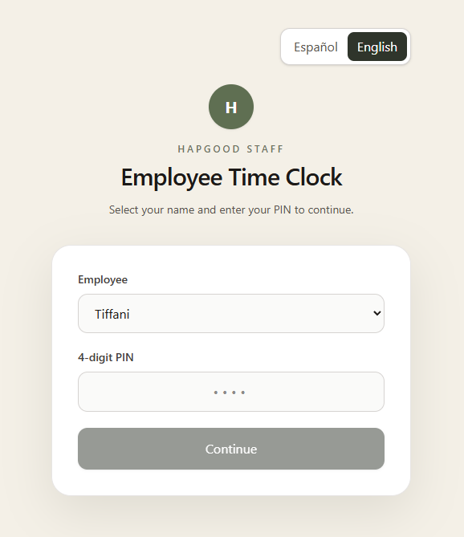
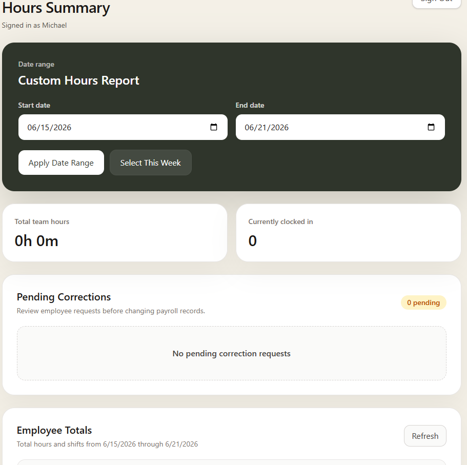
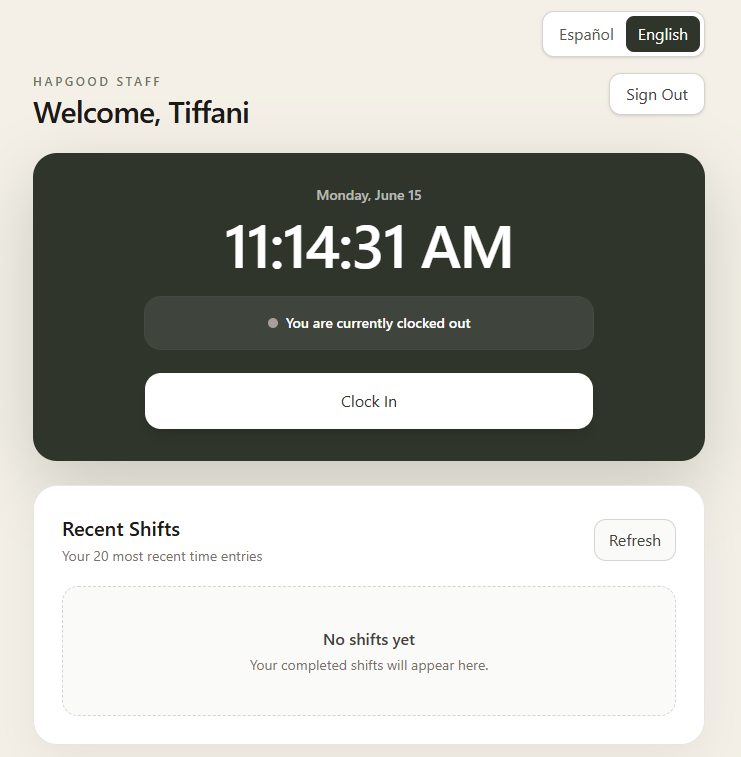

# Hapgood Clock

**ShiftClock** is a browser-based employee time clock and manager payroll dashboard built for a small restaurant team. Employees can record their hours, review shifts, and request corrections; managers can review, adjust, and approve time records before payroll.

The app is responsive, supports English and Spanish for employees, and can be installed on a phone or tablet as **two separate Progressive Web Apps (PWAs)**: an Employee Time Clock and a Manager Dashboard.

## Live App

**Production:** https://hapgood-clock.netlify.app

- **Employee Time Clock:** https://hapgood-clock.netlify.app/
- **Manager Dashboard:** https://hapgood-clock.netlify.app/manager/

The employee and manager screens have separate installation identities and Home Screen launch URLs, while sharing one Netlify site and Supabase database. Manager access is protected by server-side authorization, not simply by having a separate URL.

## Features

### Employee Experience

- Select an employee from a staff-only list and sign in with a four-digit PIN.
- Clock in and out, with a live date and time display.
- See whether a shift is active and review recent shifts and durations.
- Expand the shift history to view additional entries.
- Request corrected clock-in or clock-out times for an existing shift.
- Report a completely missed shift with the proposed times and a reason.
- Track correction and missed-shift requests as pending, approved, or rejected.
- Use a Spanish-first interface with an English/Spanish language toggle.
- Remember the selected language on the device.
- Use a responsive interface on phones, tablets, and desktop browsers.

### Manager Experience

- Separate manager login and installable dashboard at `/manager/`.
- Review employee hours and total team hours for a selected date range.
- Use the restaurant's **Tuesday–Monday payroll week**, navigate to previous weeks, or choose custom dates.
- See which employees are currently clocked in.
- Expand employee cards to inspect individual shift dates, times, durations, active status, and edit history.
- View **recorded hours**, **pending adjustments**, and **provisional hours** that include unapproved employee requests.
- Review correction and missed-shift requests alongside the affected employee's hours.
- Approve or reject requests, with an optional manager note.
- **Edit and approve** a pending request when the proposed times need adjustment, recording a reason for the manager's change.
- **Add a manual shift** for an employee, with required times and an edit reason.
- **Edit an existing time entry**, with required times and an edit reason.
- Export a readable **TXT payroll report** for the selected period.
- Automatically refresh the manager's recorded hours and pending requests after changes.

**Pending requests do not change official time entries or recorded payroll totals until approved.** Provisional totals are presented separately to help managers review expected adjustments.

### Progressive Web Apps

- Two separately installable Home Screen apps on supported devices: **Employee Time Clock** and **Manager Dashboard**.
- Each app launches directly into its respective route, even though both are hosted on the same site.
- Web app manifests, app icons, and service-worker caching for the application shell.
- Separate manager HTML entry point and a service-worker navigation rule that keeps `/manager/` from falling back to the employee page.
- An online connection is required to verify PINs, record punches, submit requests, and make manager changes.

> **Offline limitations:** ShiftClock does **not** record, queue, or synchronize offline clock-ins or clock-outs. During an internet outage, employees should record their times separately and have a manager add or correct the shift once service returns. The employee roster may be available from a previous local cache, but seeing a name offline does not mean a punch has been recorded.

## Tech Stack

- React 19
- Vite 8
- Tailwind CSS 4
- JavaScript
- Supabase (PostgreSQL and RPC)
- `vite-plugin-pwa` / Workbox
- Netlify

## Project Structure

```text
public/
  _redirects
  employee.webmanifest
  manager.webmanifest
  pwa-192x192.png
  pwa-512x512.png
manager/
  index.html
src/
  App.jsx
  index.css
  main.jsx
  supabaseClient.js
index.html
vite.config.js
package.json
package-lock.json
.env.example
.gitignore
README.md
```

The build generates both `dist/index.html` and `dist/manager/index.html`. The employee and manager manifests are copied into `dist/`.

## Getting Started

### Prerequisites

- Node.js 20.19+ (or another version supported by the installed Vite release)
- npm
- A Supabase project with the required schema and RPC functions

### Clone and install

```bash
git clone https://github.com/robregan/timeclock.git
cd timeclock
npm install
```

### Configure environment variables

Copy the example file and provide the credentials for your intended Supabase environment:

```bash
cp .env.example .env.local
```

```env
VITE_SUPABASE_URL=your_supabase_project_url
VITE_SUPABASE_PUBLISHABLE_KEY=your_supabase_publishable_key
```

Use **development Supabase credentials for local testing**. Never commit `.env.local` or expose a Supabase service-role/secret key in frontend code. Publishable keys are public by design; database authorization must be enforced server-side.

### Run locally

```bash
npm run dev
```

- Employee: http://localhost:5173/
- Manager: http://localhost:5173/manager/

To test the built PWA and service worker, use:

```bash
npm run build
npm run preview
```

Vite Preview normally runs at `http://localhost:4173`. Service-worker behavior may differ from the ordinary Vite development server.

### Available scripts

| Command | Purpose |
| --- | --- |
| `npm run dev` | Start local development |
| `npm run build` | Create production assets in `dist/` |
| `npm run preview` | Preview the production build |
| `npm run lint` | Run ESLint |

## Routing and PWA Configuration

`index.html` serves the employee time clock and references `employee.webmanifest`.

`manager/index.html` serves the manager dashboard and references `manager.webmanifest`. Vite's multi-page build includes both HTML entry points. The React interface recognizes `/manager` and `/manager/` as manager routes.

The `public/_redirects` file supplies Netlify's general SPA fallback:

```text
/* /index.html 200
```

The real `manager/index.html` output is served at `/manager/`. Workbox excludes manager navigation from the employee `index.html` fallback so the installed manager PWA opens the correct page.

## Database Overview

The application uses PostgreSQL tables and controlled Supabase RPC functions. Core tables include:

### `employees`

Employee and manager accounts, including `id`, `name`, `pin_hash`, `role`, `can_clock`, `active`, and `created_at`. PINs are stored as hashes rather than readable text. Managers are identified through their role and validated by the database functions they call.

### `time_entries`

Recorded shifts, including `id`, `employee_id`, `employee_name`, `clock_in`, `clock_out`, `created_at`, `edited_at`, `edited_by`, and `edit_reason`.

Production includes database-level safeguards:

- A partial unique index that prevents multiple simultaneously open shifts for one employee.
- `time_entries_positive_duration`: completed shifts must end after they begin.
- `no_overlapping_employee_shifts`: shifts for the same employee cannot overlap, including currently open shifts.

These protections apply to employee punches and manager changes. Adjacent shifts are permitted when one ends exactly as the next begins.

### `shift_correction_requests`

Requests of type `correction` or `missing_shift`, including the employee, requested times, explanation, status, review information, and manager note.

A correction request references an existing time entry; a missed-shift request proposes a new one. Approved requests update or create time entries, while rejected requests leave recorded payroll unchanged. The employee's original explanation is retained.

### `shift_request_edit_log`

Records changes made when a manager adjusts the proposed times of a pending employee request before approving it, including the original requested times, approved times, manager, and explanation.

## Server-Side Functions

The client accesses timekeeping operations through controlled Supabase RPC functions rather than unrestricted writes to payroll tables.

**Employee operations:**

- `list_clockable_employees`
- `verify_employee_pin`
- `clock_in_employee`
- `clock_out_employee`
- `get_employee_entries`
- `get_employee_all_entries`
- `submit_shift_correction`
- `submit_missed_shift_request`
- `get_employee_correction_requests`

**Manager operations:**

- `list_active_managers`
- `get_manager_hour_totals`
- `get_manager_shift_details`
- `get_pending_correction_requests`
- `review_shift_correction`
- `manager_approve_edited_request`
- `manager_create_manual_shift`
- `manager_update_time_entry`

These functions validate credentials, enforce relevant business rules, and return the records needed by the UI.

## Employee Requests and Manager Review

**Correct an existing shift:** An employee chooses a completed shift, enters corrected times and a reason, and submits a request. The manager can approve it, reject it, or change the proposed times and approve with a documented explanation. Approved changes update the original time entry.

**Report a missed shift:** An employee submits the missing clock-in and clock-out times with a reason. Approval creates a new time entry; rejection does not alter payroll.

**Manager-entered shifts:** A manager can independently add a missing shift or edit a recorded shift. Both operations require a reason and are subject to database validation against invalid times and overlaps.

## Payroll Reporting

Managers can select a custom range or navigate the Tuesday–Monday payroll periods. The dashboard displays employee-level and team-level recorded hours, pending adjustments, provisional totals, shift counts, current clock-in status, and individual shift details.

Hours are calculated for the portion of each shift inside the selected reporting window. Pending adjustments are shown separately until approved. Managers can export a text-based report for review before payroll.

## Security and Operational Notes

- Server-side PIN verification and manager-role checks.
- Hashed employee PINs and restricted database permissions.
- Row Level Security on protected tables.
- Validation of shift duration and overlap at the database level.
- Reasons and edit metadata retained for manager changes.
- Automatic sign-out after a period of inactivity.
- A development Supabase project separate from the production project.
- Production backups should be stored privately and restore-tested before schema changes.

A four-digit PIN is a convenience mechanism for a small workplace, **not strong authentication**. The separate manager URL and Home Screen icon do not themselves grant or enforce permission.

## Deployment

Hosted on Netlify, with `npm run build` and `dist` as the publish directory.

Required build environment variables:

- `VITE_SUPABASE_URL`
- `VITE_SUPABASE_PUBLISHABLE_KEY`

The `main` branch is used for production deployments. Development changes are tested using a separate `dev` branch, Netlify development site, and Supabase development project before release.

## Screenshots







## Roadmap

- Employee management and PIN-reset tools.
- Stronger manager authentication and failed-login throttling.
- Expanded audit and manager activity history.
- Automated production backups.
- Optional secure translation of Spanish employee request notes.
- Optional notifications for pending correction requests.
- Additional payroll export formats and presets.

## Status

**ShiftClock v2 is deployed and functional in production.** The employee and manager interfaces are separately installable, and the manager dashboard includes shift creation/editing, review workflows, provisional payroll calculations, and reporting.

Offline punching and automatic offline synchronization were explored during development but are **not part of the production app**.

## Author

Built by Rob Regan. GitHub: https://github.com/robregan

## License

Currently unlicensed; intended for private or internal workplace use.
